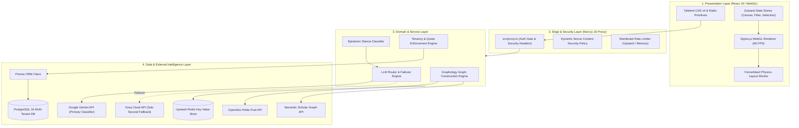
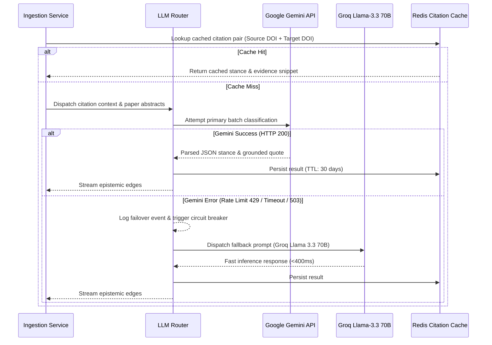

# 🏛️ Ithaca Architectural Specification

This document provides a comprehensive technical breakdown of the **Ithaca** platform architecture, detailing the epistemic classification pipeline, graph topology algorithms, dual-provider LLM cascade, multi-tenant isolation, and WebGL rendering systems.

---

## 1. High-Level Architectural Layers



---

## 2. The Epistemic Classification Engine

### 2.1 The Tri-Partite Epistemic Model

Traditional bibliometrics rely on raw citation counts. Ithaca classifies academic citations into a structured epistemic taxonomy:

| Stance         | Semantic Meaning                                              | Visual Encoding             | Criteria                                                                                                     |
| :------------- | :------------------------------------------------------------ | :-------------------------- | :----------------------------------------------------------------------------------------------------------- |
| **`SUPPORTS`** | Replicates, confirms, or provides empirical corroboration     | Emerald / Mint (`#10b981`)  | Matches findings, reproduces outcomes within confidence intervals, or confirms mechanistic hypothesis        |
| **`REFUTES`**  | Challenges, contradicts, or demonstrates methodological flaws | Crimson / Coral (`#ef4444`) | Disproves claims, reveals statistical artifacts, fails replication, or highlights contradictory in-vivo data |
| **`EXTENDS`**  | Adapts, generalizes, or builds novel architectures            | Electric Violet (`#8b5cf6`) | Proposes algorithmic modifications, expands to adjacent domains, or addresses noted limitations              |
| **`MENTIONS`** | Neutral contextual citation                                   | Muted Slate (`#64748b`)     | Background literature review, historical attribution, or definition without testing validity                 |

### 2.2 Dual-Provider LLM Cascade (`src/lib/api/llm-router.ts`)

The classification engine employs a resilient, zero-downtime routing cascade:



### 2.3 Evidence Gating Heuristics

To protect against AI hallucinations, Ithaca applies strict evidentiary gating:

1. **Confidence Threshold**: Any classification with a model confidence score below `0.65` is automatically demoted to `MENTIONS`.
2. **Passage Grounding**: The model must extract the exact substring quote from the citing paper. If the quote cannot be verified in the citing text, the stance is flagged as ungrounded.
3. **Bidirectional Disagreement Flagging**: If Paper A refutes Paper B, but Paper B cited Paper A positively (e.g. chronological update), the edge is flagged as an _Active Dialectic Controversy_.

---

## 3. Graph Processing & WebGL Rendering

### 3.1 Graphology Data Topology

Ithaca models scientific literature as a directed multigraph using `graphology`:

- **Nodes**: Scientific publications containing:
  - `doi`, `title`, `authors`, `year`, `citationCount`, `isOpenAccess`, `primaryDiscipline`.
- **Edges**: Epistemic citation relationships containing:
  - `stance` (`SUPPORTS`, `REFUTES`, `EXTENDS`, `MENTIONS`),
  - `confidence` (`0.0` - `1.0`),
  - `evidenceSnippet` (verbatim excerpt),
  - `section` (`Introduction`, `Methods`, `Results`, `Discussion`).

### 3.2 Asynchronous ForceAtlas2 Layout

To render thousands of nodes without blocking React's UI thread:

1. The graph data structure is serialized and transferred to a dedicated **Web Worker**.
2. **ForceAtlas2 Physics Simulation** executes iterations using:
   - **Barnes-Hut Optimization** ($\theta = 0.5$) for $O(N \log N)$ spatial clustering.
   - **LinLog Mode**: Increases clustering coefficient to clearly segregate opposing intellectual camps.
   - **Gravity & Scaling**: Calibrated dynamically based on node count to prevent overlap.
3. The worker posts coordinate deltas back to the main thread until the system energy stabilizes ($\Delta E < \epsilon$).

### 3.3 Sigma.js WebGL Custom Programs

- **Node Programs**: Custom GLSL shaders draw high-DPI circles with colored halos indicating paper dispute intensity (share of contradictory citations received).
- **Edge Programs**: Custom curved and directional arrow shaders color-coded according to the tri-partite epistemic model.

---

## 4. Multi-Tenant Security & Isolation

### 4.1 Tenancy Hierarchy

```
┌────────────────────────────────────────────────────────┐
│                   ORGANIZATION                         │
│   (id, name, slug, plan: SOLO | LAB | INSTITUTION)     │
└───────────┬────────────────────────────────┬───────────┘
            │ 1:N                            │ 1:N
            ▼                                ▼
┌───────────────────────┐        ┌───────────────────────┐
│      MEMBERSHIP       │        │     SAVED GRAPHS      │
│ (userId, role, seat)  │        │ (nodes, edges, state) │
└───────────┬───────────┘        └───────────────────────┘
            │ N:1
            ▼
┌───────────────────────┐
│         USER          │
│ (id, email, orcidId)  │
└───────────────────────┘
```

### 4.2 Role-Based Access Control (RBAC)

Every server action and API endpoint checks tenant permissions via `src/lib/tenancy-policy.ts`:

| Permission                                     | OWNER | ADMIN | MEMBER | VIEWER |
| :--------------------------------------------- | :---: | :---: | :----: | :----: |
| `domain:read` (View Graphs & Debates)          |  ✅   |  ✅   |   ✅   |   ✅   |
| `domain:write` (Create/Save Graphs, Run AI)    |  ✅   |  ✅   |   ✅   |   ❌   |
| `members:manage` (Invite/Remove Lab Members)   |  ✅   |  ✅   |   ❌   |   ❌   |
| `organization:manage` (Change Plans & Billing) |  ✅   |  ❌   |   ❌   |   ❌   |
| `audit:read` (View Lab Security Logs)          |  ✅   |  ✅   |   ❌   |   ❌   |

### 4.3 Database Query Scoping

All Prisma database interactions for workspace resources use the `scopeToOrganization` utility to guarantee zero cross-tenant data leakage:

```typescript
export function scopeToOrganization<T extends Record<string, unknown>>(
  organizationId: string,
  where?: T,
): Omit<T, "organizationId"> & { organizationId: string } {
  return {
    ...where,
    organizationId,
  };
}
```

---

## 5. Security & Network Hardening

### 5.1 Next.js 16 Security Proxy (`src/proxy.ts`)

In Next.js 16, edge middleware is executed via `src/proxy.ts`:

- **Cryptographic Nonce Generation**: A unique random UUID nonce is generated per request and injected into the `Content-Security-Policy` header.
- **Strict Transport Security**: Enforces `max-age=31536000; includeSubDomains` in production.
- **Fast Edge Gate**: Unauthenticated requests to protected routes (`/explore`, `/dashboard`, `/admin`, `/projects`) are intercepted at the edge and redirected to `/signin?callbackUrl=...` without waking serverless compute.

### 5.2 Session Management

- **Better Auth v5 Engine**: Uses signed, HTTP-only, SameSite-strict cookies (`ithaca.session_token`).
- **Sliding Expiration**: Sessions expire in 7 days and automatically roll forward when active within 24 hours.

---

## 6. Research Algorithms

### 6.1 Conflict Path Discovery (`/api/research/conflict-path`)

Finds the shortest dialectic disagreement chain between two publications using Dijkstra-based pathfinding weighted inversely by dispute confidence.

### 6.2 Sovereign Slice (`/api/research/sovereign-slice`)

Analyzes author co-authorship graphs across citation networks to detect whether a seeming consensus is supported by independent research laboratories or driven by self-citation networks.

---

_Document version: 2.4.0 — Maintained by Ithaca Core Engineering Team._
