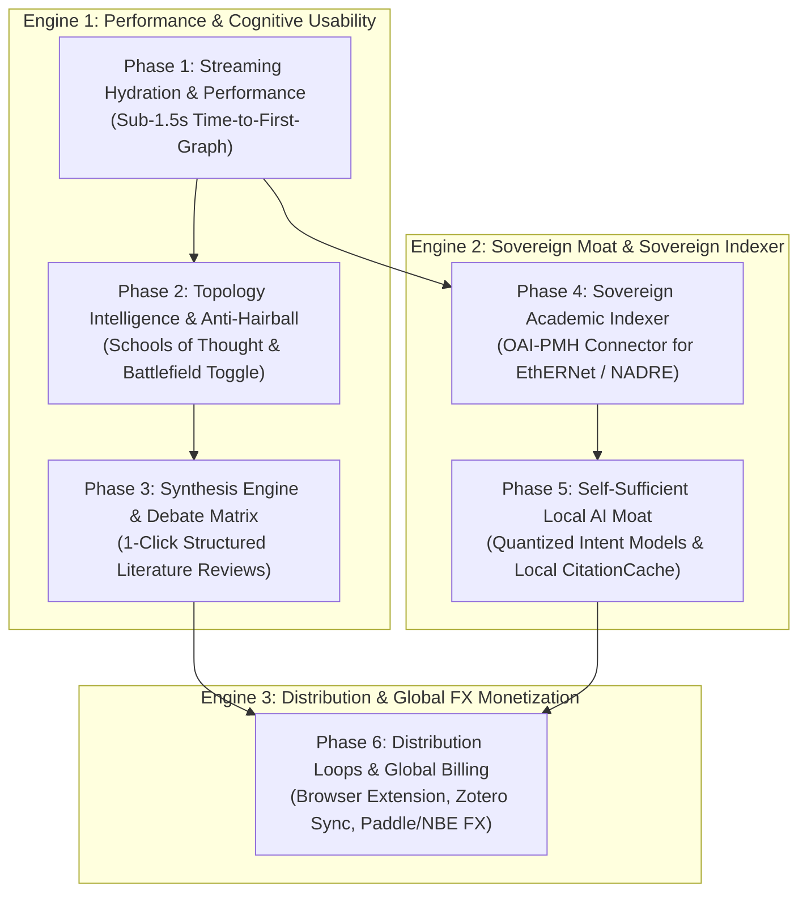

# Ithaca — Master Product & Architectural Roadmap (v3.0)

### _The Dual-Engine Forward Path: Sovereign National Research Infrastructure & High-Speed Global Research Instrument_

**North Star:** Establish Ithaca as the definitive scientific citation intelligence platform—blisteringly fast for researchers globally to map, navigate, and synthesize academic debates, while simultaneously functioning as Ethiopia's sovereign academic research indexer and digital export powerhouse under Startup Proclamation No. 1396/2025.

---

## 🧭 Executive Summary & Architectural Baseline

### What Ithaca Has Built (Current Foundation)

- **Core Visualization Engine:** WebGL graph canvas powered by `@react-sigma/core` and `graphology`, supporting dynamic ForceAtlas2 physics and chronological temporal layout.
- **Global Bibliographic Ingestion:** Real-time query and deduplication across 250M+ academic works via the OpenAlex REST API.
- **Grounded AI Intent Classification:** Multi-stage evidence gating linking Semantic Scholar in-text citation contexts to LLM classifiers (Gemini 2.0 Flash / Groq LLaMA 3.3) with versioned PostgreSQL caching (`CitationCache`, `classifierVersion: 7`).
- **Semantic Pathfinding:** Custom weighted Dijkstra algorithms computing **Shortest Path**, **Conflict Trail** (chains of scientific refutations), and **Consensus Lineage** (chains of empirical support/extension).
- **Enterprise Multi-Tenancy:** Tiered workspaces (`SOLO`, `LAB`, `INSTITUTION`), granular RBAC (`OWNER`, `ADMIN`, `MEMBER`, `VIEWER`), domain allowlisting, immutable `AuditEvent` logging, and database-backed sliding-window rate limiting (`ApiRateLimit`).
- **Code Health & Modern Stack:** Next.js 16 (App Router + Turbopack), React 19, TypeScript (0 strict type errors), and Prisma ORM on PostgreSQL.

---

## 🏛️ The Dual-Engine Strategy: Bridging Global SaaS & Sovereign Value

To make Ithaca unassailable both commercially in the international market and domestically before the **National Designation Committee (MInT)** under **Proclamation No. 1396/2025**, the platform operates on two synchronized engines:

```
┌─────────────────────────────────────────────────────────────────────────────────────────────┐
│                                  ITHACA DUAL-ENGINE PLATFORM                                │
├──────────────────────────────────────────────┬──────────────────────────────────────────────┤
│               GLOBAL SAAS ENGINE             │          SOVEREIGN ACADEMIC ENGINE           │
│         (Export Growth & FX Receipts)        │       (MInT & Ministry of Education Moat)    │
├──────────────────────────────────────────────┼──────────────────────────────────────────────┤
│ • 250M+ OpenAlex / Semantic Scholar Works    │ • EthERNet / NADRE National Repository Sync  │
│ • Sub-1.5s Streaming Edge Classification     │ • OAI-PMH Ingestion of Local University ETDs │
│ • "Battlefield" Dispute Filtering            │ • Visibility for AAU, Jimma, Hawassa Theses  │
│ • Browser Extension & Zotero Bidirectional   │ • 100% Free Access for Ethiopian Researchers │
│ • USD SaaS Billing (Stripe / Paddle)         │ • Local Quantized AI Inference (Zero FX Burn)│
│ • 100% FX Retention via NBE Directives       │ • Sovereign Digital Asset under Article 41   │
└──────────────────────────────────────────────┴──────────────────────────────────────────────┘
```

---

## 🗺️ Master Roadmap: 6 Strategic Phases



---

## ⚡ Phase 1: Performance & Streaming Hydration (Win the First 3 Seconds)

**Objective:** Eliminate the initial 15-second latency barrier by decoupling graph topology rendering from stance classification.

### 1.1 Progressive Edge Hydration (Streaming Stances via SSE)

- **The Problem:** The legacy graph builder waits for Semantic Scholar context retrieval and LLM inference before returning nodes and edges, creating perceived freezes.
- **The Solution:**
  1. **Immediate Topology Render (< 1.2s):** Return nodes and neutral citation edges (`cites`) instantly from OpenAlex.
  2. **Server-Sent Events (`/api/classify/stream`):** Asynchronously stream classified edges (`supports`, `contradicts`, `extends`) in background chunks.
  3. **Optimistic Visual Transitions:** Edge colors pulse and transition smoothly (`useEdgeFlowAnimation`) as classifications arrive.
- **Key Files:**
  - `src/lib/api/openalex-provider.ts`
  - `src/app/api/classify/stream/route.ts` (new)
  - `src/stores/canvas-store.ts`
  - `src/components/canvas/explore-canvas.tsx`

### 1.2 S2 Batching & Proactive Cache Warming

- **Batched Ingestion:** Group citation requests by citing DOI to collapse multiple paper lookups into single batched S2 requests.
- **Core Discipline Seed:** Pre-warm `CitationCache` with foundational papers across top disciplines (Transformers, CRISPR, Malaria Vaccines, Climate Models).

---

## 🔬 Phase 2: Topology Intelligence & Anti-Hairball Navigation

**Objective:** Ensure graphs with 100+ nodes remain clear, navigable, and intellectually actionable without visual overwhelm.

### 2.1 Semantic Metanodes ("Schools of Thought" Clustering)

- **Concept:** Dynamically cluster dense subgraphs sharing top-level concepts into expandable **Metanodes**.
- **Behavior:**
  - **Macro View (Zoomed Out):** Displays 4–6 high-level "Schools of Thought" clusters with dispute badges (e.g., _"Endogenous vs Exogenous Growth Models — 5 Contradictions"_).
  - **Micro View (Zoomed In / Double Click):** Metanode unpacks into individual paper nodes using localized ForceAtlas2 layout.
- **Key Files:**
  - `src/lib/graph-clustering.ts` (new Louvain / Concept grouping algorithm)
  - `src/components/canvas/explore-canvas.tsx`
  - `src/components/canvas/node-selection.tsx`

### 2.2 The "Battlefield" Dispute Filter

- **Feature:** High-contrast toolbar toggle: **"Show Disputes Only"**.
- **Effect:** Instantly dims or hides standard background citations, highlighting only direct contradictions (`contradicts`) and key confirmations (`supports`), transforming the canvas into an intellectual debate map.

---

## 📊 Phase 3: Synthesis Engine & Debate Matrix

**Objective:** Enable researchers to turn an interactive debate graph into a publication-ready literature review summary in one click.

### 3.1 One-Click "Debate Matrix" View

- **Concept:** Side-by-side comparison table of conflicting papers:
  | Paper (Year) | Core Empirical Claim | Methodology / Dataset | Stance vs Benchmark | Contested Point | Evidence Context |
  | :----------- | :------------------- | :-------------------- | :------------------ | :-------------- | :--------------- |
- **Exports:** 1-click export to **Markdown**, **CSV**, and **LaTeX Table**.
- **Key Files:**
  - `src/components/canvas/debate-matrix-dialog.tsx`
  - `src/lib/debate-report.ts`
  - `src/components/share/share-export.tsx`

### 3.2 Narrative Literature Review Synthesizer (`/api/research/synthesize`)

- **Output:** Generates a structured 3-part literature review draft:
  1. _Foundational Lineage & Shared Assumptions_
  2. _Empirical Points of Friction & Methodological Clashes_
  3. _Unresolved Controversies & Future Horizons_

---

## 🇪🇹 Phase 4: Sovereign Academic Indexer (EthERNet / NADRE Integration)

**Objective:** Transform Ithaca into sovereign national research infrastructure, giving the Ministry of Education and university rectors an undeniable reason to champion, designate, and fund Ithaca under Proclamation 1396/2025.

### 4.1 Native OAI-PMH Ingestion Connector

- **Target Repositories:** Institutional DSpace repositories across Ethiopian Universities:
  - Addis Ababa University (AAU ETD Repository)
  - Jimma University Institutional Repository
  - Hawassa, Mekelle, Gondar, and ASTU Repositories
  - National Academic Digital Repository of Ethiopia (NADRE / EthERNet)
- **Ingestion Protocol:** Build an automated Dublin Core OAI-PMH harvester:
  - Extracts thesis metadata, authors, abstracts, advisors, and reference bibliographies.
  - Automatically deduplicates and indexes them into Ithaca's `PaperRecord` table with provenance tags (`source: "NADRE_ETHIOPIA"`).
- **Key Files:**
  - `src/lib/api/oai-pmh-client.ts` (new)
  - `src/app/api/jobs/harvest-nadre/route.ts` (new background worker)
  - `prisma/schema.prisma` (add `institutionSlug` and `isSovereignIndex` flags)

### 4.2 The "National Research Explorer" Portal

- **Feature:** A dedicated portal mode (`/explore/ethiopia`) allowing scholars to visualize the citation and collaboration network between Ethiopian universities and international literature.
- **National Impact:** Eliminates research redundancy, highlights local academic contributions, and provides MoE with real-time research output analytics.

---

## 🧠 Phase 5: Self-Sufficient Local AI Moat & Offline Citation Engine

**Objective:** Decouple Ithaca from foreign currency-draining API dependencies, establishing a defensible, proprietary domestic AI asset under Article 41 of the Startup Proclamation.

### 5.1 Localized Intent Classification Pipeline

- **The Shift:** Replace continuous OpenAI/Gemini runtime API calls with a local, fine-tuned, quantized sentence-transformer / DeBERTa classification engine running on internal CPU/GPU infrastructure.
- **Architecture:**
  - Step 1: Deterministic intent and context extraction via regex and S2 metadata.
  - Step 2: Local inference model (8-bit quantized, sub-15ms latency) evaluating semantic stance (`supports`, `contradicts`, `extends`).
  - Step 3: Permanent indexing into `CitationCache` with confidence scores and evidence sentences.
- **Zero FX Burn:** Operates entirely within the local server environment without incurring recurring USD API fees.

### 5.2 Human-in-the-Loop Community Calibration (`/api/classify/correct`)

- Allow verified researchers and university professors to confirm or dispute citation classifications with 1-click verified reviews, creating a proprietary fine-tuning dataset unique to Ithaca.

---

## 🌐 Phase 6: Global Distribution Loops & FX Export Monetization

**Objective:** Establish sustainable commercial revenue by capturing international subscriptions in foreign currency, leveraging NBE's 100% FX retention directive.

### 6.1 The Ithaca Browser Extension (Chrome & Firefox)

- **Behavior:** Seamlessly overlays Ithaca badges on arXiv, PubMed, Nature, and Google Scholar:
  > **Ithaca Debate:** 🟢 12 Supporting · 🔴 3 Contradicting · 🟣 7 Extending
- Clicking the badge opens the interactive debate canvas directly in Ithaca.

### 6.2 Bidirectional Zotero & Mendeley OAuth Sync

- Direct OAuth integration importing researcher Zotero collections and continuously monitoring them for newly published conflicting studies.

### 6.3 Global SaaS Billing & NBE Foreign Exchange Inflow

- **Payment Architecture:** Deploy a Merchant of Record (Paddle / LemonSqueezy) for seamless cross-border credit card checkout:
  - **SOLO Pro:** $15/month (individual researchers)
  - **LAB Plan:** $99/month (10 collaborative lab seats)
  - **INSTITUTION:** $5,000–$25,000/year (university site licenses)
- **Domestic Sovereign Tier:** **100% Free** for all accredited Ethiopian universities and researchers using `.edu.et` email addresses.
- **NBE Compliance:** Direct USD subscription receipts channeled into Ithaca's local NBE foreign exchange retention account, legally retained at 100% to fund ongoing infrastructure and expansion.

---

## 📅 Roadmap Execution Timeline

| Milestone       | Target Horizon  | Primary Deliverable                                              | Regulatory & Product Metric                    |
| :-------------- | :-------------- | :--------------------------------------------------------------- | :--------------------------------------------- |
| **Milestone 1** | **Weeks 1–3**   | Phase 1 (Streaming SSE Hydration) + Phase 2 (Battlefield Filter) | Time-to-graph < 1.5s; 0 canvas freezes         |
| **Milestone 2** | **Weeks 4–6**   | Phase 4 (EthERNet / NADRE OAI-PMH Ingestion Connector)           | Ingest AAU & Jimma sample ETD collections      |
| **Milestone 3** | **Weeks 7–9**   | Phase 3 (Debate Matrix & Literature Review Synthesizer)          | 1-click LaTeX / Markdown export operational    |
| **Milestone 4** | **Weeks 10–12** | Phase 5 (Local Quantized Intent Classifier Engine)               | Zero foreign LLM dependency for standard runs  |
| **Milestone 5** | **Weeks 13–16** | Phase 6 (Browser Extension MVP + Global Billing Integration)     | First international USD subscription processed |

---

## 🔒 Definition of Done & Quality Standards

Before any milestone is merged into production:

1. **Zero-Error Type Safety:** `npm run typecheck` passes with zero errors.
2. **Automated Verification:** All Vitest unit tests and Playwright E2E suites pass cleanly.
3. **Performance Budget:** 55–60 FPS maintained during canvas pan/zoom on 500+ node graphs.
4. **Sovereign Interoperability:** OAI-PMH endpoints parse and normalize Dublin Core XML without data loss.
5. **Security & Data Isolation:** Complete multi-tenant isolation with OWASP compliance and DB-backed sliding-window rate limiting.
